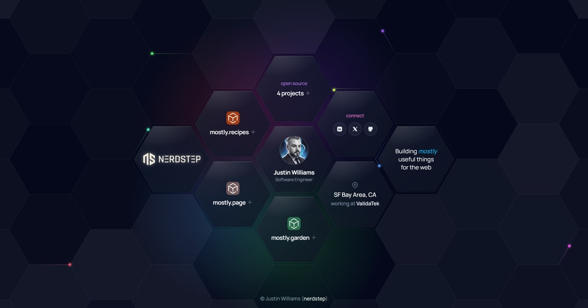

# nerdstep.com

This is my personal corner of the web. I'm Justin, a software engineer in the San Francisco Bay Area, and this is where I show off the things I build, mostly the mostly.* family of local-first apps and the open source that grew out of them.

**[nerdstep.com](https://nerdstep.com)**



## The idea

I wanted something more fun than a résumé page, so the home page is a honeycomb. Every project gets its own glass cell, and the background grid is drawn on the same lattice, so the whole thing reads as one hive with the projects lit up inside it. Each project has its own color, and those are the only colors on the page. Hover a cell and its rim lights up. Little particles wander along the channels between the cells.

Click a project and a drawer slides in with a screenshot, a short write-up, and links to the live app or the repo. Every project has its own link too, like [nerdstep.com/?p=mostly-recipes](https://nerdstep.com/?p=mostly-recipes).

The design details are documented in [DESIGN.md](DESIGN.md).

## How it's built

It runs on the same stack as my mostly.* apps.

- [TanStack Start](https://tanstack.com/start) and React 19, with the React Compiler (via `oxc-transform-react`)
- [Cloudflare Workers](https://workers.cloudflare.com) for hosting
- Tailwind CSS v4 and [Base UI](https://base-ui.com), in the shadcn base-nova style
- [Motion](https://motion.dev) for the entrance animation, and plain CSS and SVG for the rest
- Manrope for every bit of text
- Bun, oxfmt, and oxlint for tooling

## Running it

```sh
bun install
bun run dev      # http://localhost:3100
```

## License

The code is MIT licensed (see [LICENSE](LICENSE)), so feel free to borrow from it.

The art and branding are mine, though. That covers the nerdstep name, logo, and NS mark (and the favicons and app icons made from it), my photos, the project icons and screenshots, and the social card. Those are © Justin Williams, all rights reserved, so please don't reuse them. Manrope is used under the SIL Open Font License, and any third-party logos belong to their owners.
